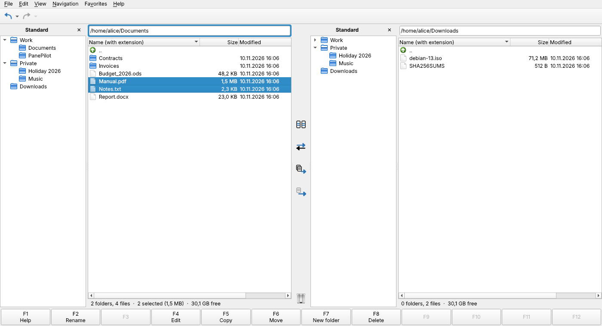
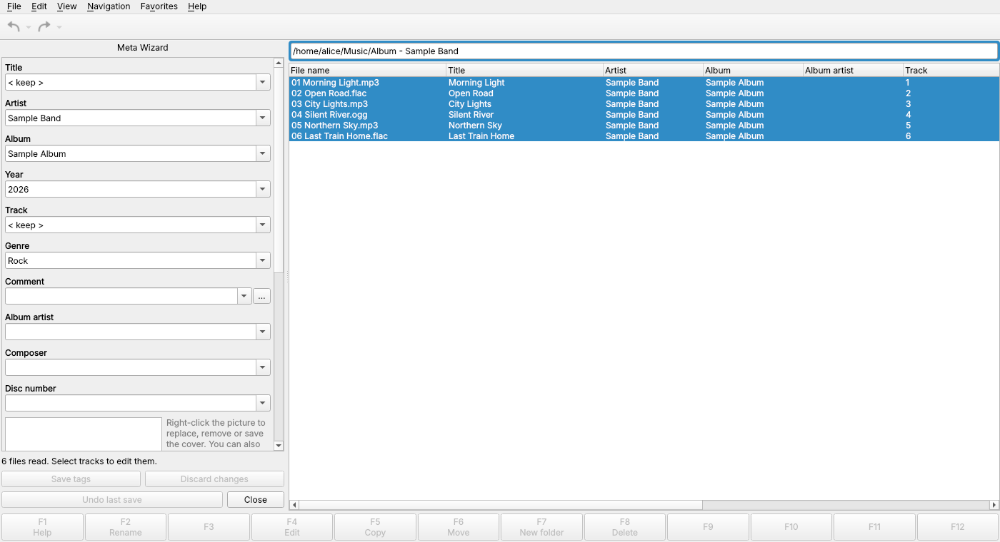
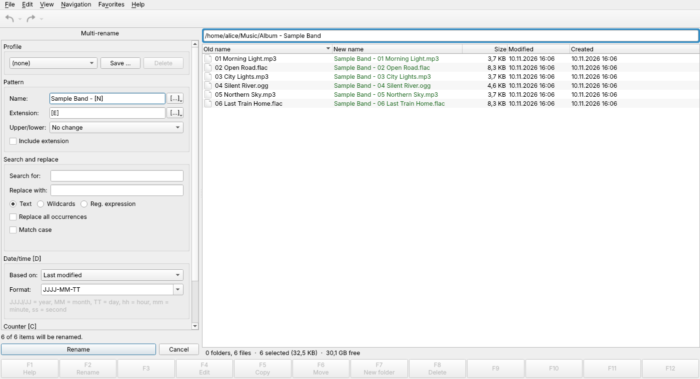

# PanePilot

**A free two-panel file manager for Linux and Windows, inspired by FreeCommander.**

PanePilot brings together what usually takes three or four programs: a classic two-panel file manager, a powerful multi-rename tool, a music tag editor in the style of MP3TAG, and a checksum tool – in one fast, keyboard-friendly application.



[**⬇ Download the latest release**](https://github.com/NEA1971/PanePilot/releases/latest) · [Report a bug / suggest a feature](https://github.com/NEA1971/PanePilot/issues/new/choose) · [Discussions](https://github.com/NEA1971/PanePilot/discussions) · [☕ Support on Ko-fi](https://ko-fi.com/panepilot)

🇩🇪 [Deutsche Beschreibung weiter unten](#deutsch)

## Features

- **Two panels** with folder tree, nested favourites, drive overview (including network shares and USB drives that are not mounted yet), filters, column profiles and a single-panel view
- **File operations**: copy, move, rename, trash, archives (compress / extract), drag & drop to and from other applications, “Open with”, properties, “Open terminal here”, directory listings as text file
- **FTP/SFTP client**: servers in a sidebar, FTP, FTP over TLS and SFTP shown in the normal file panel, transfer queue with progress, passwords in the system keyring, import from FileZilla
- **Search** by name (wildcards, several patterns) and by content, with depth limit; results appear as a normal panel
- **Find duplicates**: same content (checksum), same name without extension or same name and size; check and move to trash
- **Multi-rename** with placeholders, counters, dates, search & replace (text, wildcards, regular expressions), live preview, profiles and undo
- **Meta wizard** for music tags (MP3, FLAC, Ogg, Opus, M4A, WMA, WAV), photo and video metadata:
  - edit tags and covers for many files at once
  - converters: file name ↔ tag, tag → tag, text/CSV export and import, track and disc numbering
  - **photo metadata** (EXIF, IPTC, XMP): title, keywords, rating, date taken, GPS removal, date shift, rename by date taken
  - **video metadata** (MP4, MOV, WMV, MKV/WebM; AVI and MTS read-only): title, description, author, genre, thumbnail, date taken, GPS removal, duration, resolution and codecs
  - **MusicBrainz** lookup: album search, track assignment, field selection and cover (Cover Art Archive)
  - M3U8 playlists
  - **ReplayGain** (EBU R128, via ffmpeg)
- **Checksums**: CRC32, MD5, SHA-1, SHA-256, SHA-512, with comparison and drag & drop of checksum files (`SHA256SUMS`, `.md5`, SFV …)
- **Fully configurable**: keyboard shortcuts, function-key bar (four layers), toolbar, sidebars
- **Seven languages**: English, German, Spanish, French, Russian, Franconian and Upper Saxon. You can edit any language or add your own.
- **Built-in help** (F1 opens the page for the current function) and automatic daily backup of all settings
- **UI scaling** (50–200 %) for high-resolution screens, optional entry in the application menu
- Optional **update check** (off by default): downloads a new AppImage next to the current one

| Meta wizard | Multi-rename |
|---|---|
|  |  |

## Installation

Every [release](https://github.com/NEA1971/PanePilot/releases/latest) offers three files for 64-bit Linux (x86_64):

- **`.deb`** for Debian 12/13, Ubuntu 22.04+ and Linux Mint: double-click, or `sudo apt install ./PanePilot-x.y.z-amd64.deb`.
- **`.rpm`** for Fedora, openSUSE and RHEL/Rocky/Alma: `sudo dnf install ./PanePilot-x.y.z-x86_64.rpm`
  (openSUSE: `sudo zypper install ./PanePilot-x.y.z-x86_64.rpm`).
- **AppImage** – runs without installation (see below).

The packages install to `/opt/panepilot` with a menu entry and pull in ffmpeg, mkvtoolnix and exiftool as
recommended tools. Remove with `sudo apt remove panepilot` or `sudo dnf remove panepilot`.

### AppImage

1. Download `PanePilot-x.y.z-x86_64.AppImage` from the [latest release](https://github.com/NEA1971/PanePilot/releases/latest).
2. Make it executable: right-click → Properties → “Executable as program”, or `chmod +x PanePilot-*.AppImage`.
3. Double-click to start.
4. Optional: *Settings ▸ General ▸ Display ▸ Add to application menu* creates a launcher with icon.

PanePilot supports [AppImageUpdate](https://github.com/AppImageCommunity/AppImageUpdate) and Gear Lever for delta updates.

Optional: install `ffmpeg` (e.g. `sudo apt install ffmpeg`) to use ReplayGain.

Settings are stored in `~/.config/PanePilot/`.

### Windows 10/11 (64-bit)

- **`PanePilot-x.y.z-windows-x64-setup.exe`** installs to `C:\Program Files\PanePilot` with a Start menu entry; uninstall via “Apps & features”.
- **`PanePilot-x.y.z-windows-x64.zip`** – portable, just extract and start `PanePilot.exe`.

PanePilot is not code-signed, so Windows SmartScreen warns on the first start (“More info” → “Run anyway”). Settings are stored in `%APPDATA%\PanePilot`. Video functions and the helper tools (ffmpeg, exiftool, MKVToolNix, 7-Zip) follow in 3.1.

## Feedback

- Found a bug or have an idea? Please open an [issue](https://github.com/NEA1971/PanePilot/issues/new/choose). The **System** tab in *Help ▸ About PanePilot* has a **Copy** button for the technical details.
- Questions and general discussion: [Discussions](https://github.com/NEA1971/PanePilot/discussions).

## Support

PanePilot is free and will stay free. If you like it, you can support its development with a coffee on [**Ko-fi**](https://ko-fi.com/panepilot). Supporters receive a personal code that removes the friendly reminder in the app.

## Building from source

```bash
pip install -r requirements-dev.txt
PYTHONPATH=src python -m panepilot      # run
QT_QPA_PLATFORM=offscreen pytest        # tests
packaging/build_appimage.sh             # build the AppImage (see the release workflow)
packaging/build_packages.sh             # then .deb and .rpm from the same build
```

Python 3 (tested with 3.12) and Qt 6 (PySide6). Releases are built by GitHub Actions: bump the version in `src/panepilot/__init__.py`, add `docs/releases/vX.Y.Z.md` and push to `main`.

## License

PanePilot is free software, licensed under the [GNU General Public License v3.0 or later](LICENSE).
© 2026 NEA1971

---

<a id="deutsch"></a>
## 🇩🇪 Deutsch

**PanePilot ist ein kostenloser Zwei-Fenster-Dateimanager für Linux und Windows nach dem Vorbild von FreeCommander.**

Er vereint, wofür man sonst drei oder vier Programme braucht:
- Dateimanager mit zwei Fenstern, Ordnerbaum, Favoriten und Laufwerken
- Suche nach Namen und Inhalt, Duplikate finden
- Mehrfach-Umbenennen mit Vorschau
- **FTP/SFTP-Client** mit Serverliste in der Seitenleiste und Übertragungsliste
- **Meta-Wizard** für Musik-Tags wie MP3TAG (mit MusicBrainz, ReplayGain und Playlists) und für Foto- und Video-Metadaten
- **Prüfsummen** zum Vergleichen von Downloads

Die Oberfläche gibt es komplett auf Deutsch, die Hilfe mit F1 ebenfalls.

**Installation:**
- **Debian, Ubuntu, Mint:** die `.deb`-Datei unter [Releases](https://github.com/NEA1971/PanePilot/releases/latest) herunterladen und per Doppelklick installieren (oder `sudo apt install ./PanePilot-x.y.z-amd64.deb`).
- **Fedora, openSUSE:** die `.rpm`-Datei, z. B. `sudo dnf install ./PanePilot-x.y.z-x86_64.rpm`.
- **Ohne Installation:** das AppImage herunterladen, ausführbar machen (Rechtsklick → Eigenschaften → „Als Programm ausführbar“) und per Doppelklick starten.
- **Windows 10/11:** `PanePilot-x.y.z-windows-x64-setup.exe` installieren oder das portable ZIP entpacken. Beim ersten Start warnt Windows, weil PanePilot nicht signiert ist: „Weitere Informationen“ → „Trotzdem ausführen“.

**Rückmeldungen:** Fehler und Wünsche gern als [Issue](https://github.com/NEA1971/PanePilot/issues/new/choose), auch auf Deutsch. Fragen in den [Discussions](https://github.com/NEA1971/PanePilot/discussions).

**Unterstützen:** PanePilot ist und bleibt kostenlos. Wer die Weiterentwicklung unterstützen möchte, kann das über [Ko-fi](https://ko-fi.com/panepilot) tun.
